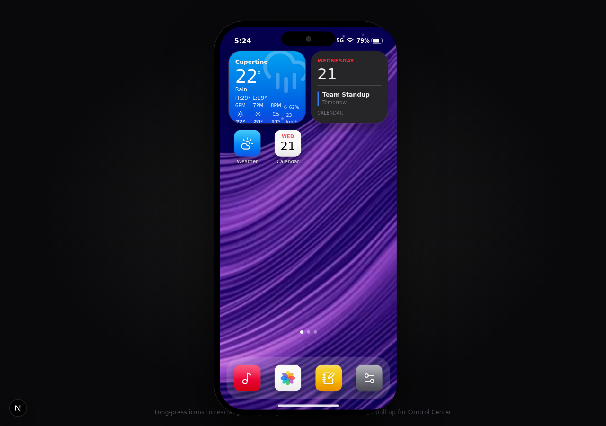

# iOS Home — Web Edition 📱

A polished, mobile-native iOS-style home screen that runs entirely in the browser. Built with **Next.js 16**, **TypeScript**, **Tailwind CSS 4**, **framer-motion**, **zustand**, and the **Web Audio API**.



## ✨ Highlights

| Area | Details |
| --- | --- |
| **Home screen** | Squircle app icons, frosted-glass dock, page dots, App Library page |
| **Swipeable pages** | Pointer-driven paging with velocity snap, rubber-banding at the edges, and a **parallax wallpaper** that drifts at 28% of page speed |
| **Wiggle mode** | Long-press any icon to jiggle the layout — drag to reorder/swap, drag to the screen edge to move across pages, minus badge to remove (apps land in the App Library) |
| **Notification Center** | Pull down from the top edge — frosted blur, live cards, swipe or tap to dismiss |
| **Control Center** | Pull up from the bottom edge — working Wi-Fi/Bluetooth/Airplane toggles, dark mode, flashlight, low-power mode, brightness & volume sliders, mini player |
| **App launch** | Apps zoom out of their icon position with a spring scale + cross-fade |
| **Live widgets** | Weather, Calendar (Up Next), Music (now playing), Photos (Memories) — all pulse subtly when their data refreshes |
| **Dynamic Island** | Expands while music plays with animated EQ bars and a marquee title |

## 🧩 The six apps

- **Weather** — simulated Cupertino forecast: current conditions, 10-hour strip, 7-day range bars, and detail cards. Updates live every 30 s.
- **Music** — four demo tracks that are *synthesized live in your browser* (chords, bass, melody, kick & hats via Web Audio — nothing is streamed). Play/pause, seek, volume, auto-advance, Up Next.
- **Photos** — a starter AI-generated gallery with a full-screen swipeable viewer and likes.
- **Notes** — full CRUD with autosave; notes persist to `localStorage`.
- **Calendar** — read-only sample month that regenerates around today's date.
- **Settings** — light/dark/auto theme, three wallpapers, brightness/volume, connectivity toggles, reset home layout, About.

## 🚀 Run locally

```bash
bun install   # or npm install
bun run dev   # or npm run dev
```

Open http://localhost:3000 — best viewed in a Chromium-based browser.

## 🖥️ Gestures cheat-sheet

- **Swipe** left/right — change page (wallpaper parallaxes)
- **Long-press** an icon — wiggle mode (drag to rearrange, ✕ badge to remove, **Done** to finish)
- **Pull down** from the top — Notification Center
- **Pull up** from the bottom — Control Center (or go home while in an app)
- **Tap the Dynamic Island** — jump to the Music app

## 🏗️ Architecture

```
src/
  app/                  # Next.js App Router (single route)
  components/ios/       # PhoneShell, HomeScreen, AppOverlay, panels, widgets, apps
  lib/ios/              # zustand store, synth engine, weather/calendar simulation, hooks
public/                 # AI-generated wallpapers, photos, album covers
scripts/gen-assets.ts   # asset generation pipeline (z-ai-web-dev-sdk + sharp)
```

State persists to `localStorage` (layout, notes, settings) so your home screen survives refreshes.

## 🌐 Deployment

Also live as a Hugging Face Space (Docker SDK) — see the `Dockerfile`.

---

Built with Z.ai Code. Wallpaper, gallery photos, and album art generated with image-generation AI.
